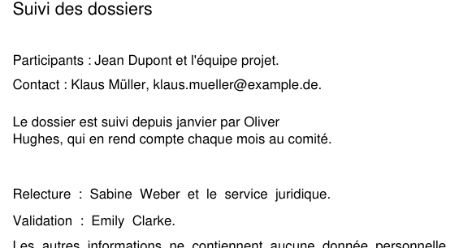
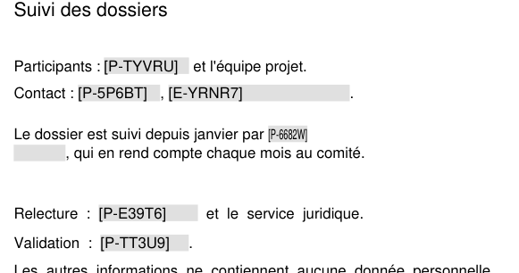

# Deviations and technical decisions

This file records the deviations between the design prompt and what was actually implemented, as well as the results of the phase 0 spikes.

## Spikes

### 0.1 Token survival in the translation tool

Scripts: `spikes/token-survival/make.ts` (generates `token_survival.docx` and `token_survival.md`: 20 FR/DE/EN sentences, the tokens `⟦P-K7M2X⟧`, `⟦O-R4N8Q⟧`, `⟦E-W3X9Z⟧` at the start, middle and end of a sentence, in a table and in a footnote, 33 occurrences in total) and `spikes/token-survival/check.ts` (classifies each occurrence: intact, mangled according to a permissive regex — ASCII brackets, typographic dashes, spaces, case —, or missing; exit code 0 if 100 % intact).

```
cd spikes && npm ci
npm run token-survival:make
# run spikes/token-survival/out/token_survival.docx and .md through the translation tool
npm run token-survival:check -- <translated file>
```

Automatic checks: unmodified generated files → 33/33 intact (`.docx` and `.md`); copy altered by hand (ASCII brackets, `⟦e – w3x9z⟧`) → every occurrence classified as "mangled", exit code 1.

**Status: human step pending.** The run through the real translation tool could not be done by the agent. Since the token format is a closed decision of the prompt, development continues with `⟦X-ABCDE⟧`; if the human result is not 100 % intact, the decision on the format remains to be made (only `engine/tokens.ts` and its tests depend on it).

### 0.2 NER in the browser

Vite page `spikes/ner-browser/` (`token-classification` pipeline from transformers.js 4.3 in a Worker) and automated bench `spikes/ner-browser/bench.ts` (Playwright: fresh context = empty cache for the "cold" measurement, reload in the same context for "warm"). Corpus: 10 fictitious sentences per language (`corpus.ts`) with traps — Polish and Turkish names, first names alone, capitalized German common nouns, « Bill will bill », names alone as in a table cell — i.e. 52 expected entities; long text of 2,208 words analyzed in 200-word windows. Machine: MacBook Pro M1 Pro, 32 GB, fiber. Quantization `q8`.

| Browser      | Model                                      | Backend | Downloaded | Cold / warm load | 2,208 words | Exact FR / DE / EN    | Leaks | False positives           |
| ------------ | ------------------------------------------ | ------- | ---------- | ---------------- | ----------- | --------------------- | ----- | ------------------------- |
| Chromium 156 | bert-base-multilingual-cased-ner-hrl       | WASM    | 181.4 MB   | 4.3 s / 0.7 s    | 14.4 s      | 18/19 · 15/16 · 16/17 | 0     | « Commission », « Stadt » |
| Chromium 156 | bert-base-multilingual-cased-ner-hrl       | WebGPU  | 181.4 MB   | 4.4 s / 0.8 s    | 52.7 s      | 18/19 · 15/16 · 16/17 | 0     | « Commission »            |
| Chromium 156 | distilbert-base-multilingual-cased-ner-hrl | WASM    | 138.3 MB   | 3.9 s / 0.5 s    | 7.3 s       | 17/19 · 16/16 · 17/17 | 0     | « Commission »            |
| Chromium 156 | distilbert-base-multilingual-cased-ner-hrl | WebGPU  | 138.3 MB   | 3.7 s / 0.8 s    | 35.4 s      | 17/19 · 16/16 · 17/17 | 0     | « Commission »            |
| WebKit 27.2  | bert-base-multilingual-cased-ner-hrl       | WASM    | 181.4 MB   | 5.1 s / 1.5 s    | 21.1 s      | 18/19 · 15/16 · 16/17 | 0     | « Commission », « Stadt » |
| WebKit 27.2  | bert-base-multilingual-cased-ner-hrl       | WebGPU  | 181.4 MB   | 6.0 s / —        | 23.0 s      | —                     | —     | — (tab crashed on reload) |

"Exact" = same text and same type; no expected entity went undetected ("leaks" = 0) in any configuration. Observed discrepancies (entities replaced but with different boundaries or a different type): « mairie de Strasbourg » detected as an organization (both models), « préfecture de Marseille » likewise (distilbert); with bert, « Mühlenstraße » reduced to « Mühle » and « Małgorzata » split into « Ma » + « łgorzata Zielińska » — in both cases a **sub-token boundary**: the `simple` aggregation of transformers.js does not group at the word level. Consequence for `ner.ts`: extend each entity to word boundaries (§2.5).

Technical findings:

- The transformers.js `token-classification` pipeline **does not return offsets** (`start`/`end`) and silently truncates at 512 sub-tokens. `ner.ts` must therefore tokenize by itself, align sub-tokens with the text to recover character offsets, split into windows and aggregate (BIO) at the word level. Deviation from the prompt ("`aggregation_strategy`"): aggregation is done in `ner.ts`, not by the library.
- WebGPU is exposed by Chromium and WebKit in headless mode, but with a software adapter: 3 to 5 times slower than WASM. On a real GPU the ratio may reverse; the prompt's automatic WebGPU → WASM choice is kept, to be recalibrated in 6.1/6.2 on real workstations. WebKit/WebGPU crashed the tab on reload.
- `performance.memory` does not exist in a Worker (nor outside Chromium): peak memory not measured.
- Firefox could not be launched in the agent's environment (see 0.3); Safari is approximated by WebKit (Playwright).
- GLiNER (`onnx-community/gliner_multi-v2.1`) discarded without measurement: 349 MB in `q8` and requires a dedicated runtime library (outside the allowed dependencies).

**Recommendation**: keep `Xenova/bert-base-multilingual-cased-ner-hrl` (the prompt's choice), usable: 4–5 s cold load on a good connection, < 1.5 s warm, ~7 s per 1,000 words in WASM. `Xenova/distilbert-base-multilingual-cased-ner-hrl` is a credible alternative (−24 % download, 2× faster, equivalent quality on this small corpus); the `NER_MODEL` constant in `ner.ts` allows switching. The final decision belongs to calibration (6.2). No signal to switch to plan B.

### 0.3 Lossless OOXML rewriting

Script: `spikes/ooxml-roundtrip/run.ts`. Inputs: a `.docx`, a `.pptx` and a `.xlsx` produced by `docx`, `pptxgenjs` and `exceljs` (styles, image, table, header/footer, rich text, formula, date), plus a `.docx` and a `.pptx` produced from the Microsoft templates bundled with python-docx/python-pptx (`ooxml-roundtrip/py_inputs.py`), closer to a real Office file (`mc:Ignorable`, `w14`/`w15` namespaces…). Procedure: JSZip opens the zip, `DOMParser` (xmldom in Node, native in Chromium and WebKit via Playwright) parses the part, a single text node is replaced with `⟦P-K7M2X⟧ & <x> "q"` with `xml:space="preserve"`, the part is re-serialized and the zip repacked. The produced files are validated by `ooxml-roundtrip/validate.py` (opening with python-docx, python-pptx, openpyxl; all XML parts well-formed; zip CRC): 5/5 OK, token present.

Results and rules adopted for `ooxml/zip.ts` and `ooxml/xml.ts`:

1. **Phantom folders.** `JSZip.loadAsync` and `zip.file()` create folder entries by default (`word/`, `ppt/`…) that are absent from files produced by Office: the rewritten zip gained 1 to 2 entries and the order changed. Rule: always `createFolders: false` when loading **and** when writing a part.
2. **Compression method.** `generateAsync({ compression })` applies the global method to loaded entries: the `STORE` entries of a pptxgenjs `.pptx` were recompressed as `DEFLATE` (0/20 identical compressed bytes). Rule: read the original method of each entry from the zip's central directory (minimal reader, `spikes/ooxml-roundtrip/zipdir.ts`) and set it on `ZipObject.options.compression` before `generateAsync`. With these two rules: entry order preserved, and for all unmodified parts identical content, method **and compressed bytes** (21/21, 20/20, 9/9, 18/18, 43/43).
3. **XML declaration.** xmldom keeps it as is; Chromium and WebKit rewrite it (`"` instead of `'`) and remove the line break that follows it. Rule: strip any leading declaration from the serializer output and prepend the original declaration **with** its trailing whitespace (including a possible `\r\n`).
4. **Order of attributes and namespace declarations.** xmldom and WebKit preserve the order; Chromium reorders it (`xmlns` declarations grouped). The multiset of declarations and the number of attributes are identical in all cases, including unused declarations that `mc:Ignorable` depends on. Attribute order has no meaning in XML: accepted. Consequence: the tests (xmldom) cannot compare a _modified_ part byte for byte with the browser output; they compare textual content and structure.
5. **Entities.** `&quot;` and `&apos;` in text are re-serialized as `"` and `'` (equivalent); `&amp;`, `&lt;`, `&gt;` are preserved. Accepted.
6. **Empty elements.** WebKit serializes `<a></a>` as `<a/>` (equivalent). Accepted.
7. **CRLF.** The parser normalizes `\r\n` to `\n` inside a part (the case of pptxgenjs files). Only modified parts are affected; no effect on Office. Accepted, rule 3 preserves the `\r\n` after the declaration.
8. **`xml:space="preserve"`** set with `setAttributeNS("http://www.w3.org/XML/1998/namespace", "xml:space", …)`: serialized correctly by all three implementations, without a spurious namespace declaration.
9. **`mc:Ignorable`** and the root tag: preserved (up to order, rule 4).

Spike limitations: Firefox could not be launched by Playwright in the agent's environment ("Could not find profile folder", sandbox); it is covered by CI. Opening "without repair" in Word and LibreOffice could not be verified by the agent (LibreOffice not installed, Word not drivable without a UI): the `spikes/out/roundtrip-*` files must be opened by hand. Structural validation serves as the automatic check.

### 0.4 Anonymized PDF output (feedback 4: "PDFs are turned into Markdown: why, and how to avoid it?")

Until this spike, a PDF was only read (pdf.js) and the anonymized document was a `.md`. The question was whether an anonymized `.pdf` can be produced in the browser, safely.

Script: `spikes/pdf-output/run.ts` (run from the repository root, it uses the application's code). For each PDF it runs the detection of the application without AI (patterns + name list), or takes the values of an existing mapping (`--mapping`), then applies approaches B and C, measures A, and compares renderings (pdf.js + `@napi-rs/canvas`, 100 dpi; a pixel "changes" when a channel moves by more than 32/255; redacted zones dilated by 3 px are excluded). `spikes/pdf-output/mupdf_check.py` re-checks every produced file with an independent reader (MuPDF): text extraction and every non-image, non-font object of the file. Corpus: `tests/fixtures/sample.pdf`, the new fixtures `pdf-fragments.pdf` (Helvetica; value split over several text blocks, space rendered by a `TJ` kerning, name cut at the end of a line with `'`, word spacing with `"`, `ActualText`, footer in a form XObject, `mailto:` link, title and author, structure tree), `pdf-composite.pdf` (Type0 `Identity-H` subset TrueType font, `ı`), `pdf-type3.pdf` (name in a Type3 font), `pdf-ocr.pdf` (invisible text over an image), `scanned.pdf`; one real PDF of `tests/real/` (CSE newsletter exported by Word: tagged, 8 TrueType WinAnsi subsets + 4 Type0 `Identity-H` subsets, all with `ToUnicode`; values: the mapping of its earlier anonymization with AI detection, 12 values, 20 occurrences); a synthetic 100-page PDF (Helvetica, 3,000 occurrences). Machine: MacBook Pro M1 Pro, Node 26.

**A. Rewriting with the original font, shifting the rest of the line.** Not implemented beyond measurement, because its two premises fail. (1) Re-encoding the token in the original font: no original font of the corpus has `⟦` or `⟧` (0 of the 44 occurrences measured, plus the 3,000 synthetic ones), so the token always needs another font anyway. (2) Shifting the following fragments: a PDF has no line model, only positioned fragments; Word writes one text block per word group with an absolute position, so "shifting the rest of the line" means re-laying out justified text without knowing where lines and columns end. In the corpus the token was wider than the value 3 times out of 44 (never in the synthetic file), and shifting the rest of the line would never have pushed it past the right margin, so the gain over B would be cosmetic.

**B. Real redaction (content-stream rewriting) — retained.** `src/adapters/pdfContent.ts` (content-stream lexer), `pdfFonts.ts` (character codes, Unicode via `ToUnicode` or the encoding, widths via `Widths`/`W` or the standard metrics), `pdfRewrite.ts`. Each content stream (page, form XObject) is replayed to get every glyph with its position, text and advance; the detected values are searched in this text (flexible whitespace, word boundaries, a separator inserted where glyphs are not contiguous); the matching glyphs are **removed** from their `Tj`/`TJ`/`'`/`"` operator and replaced by a `TJ` displacement of the same advance, so the following glyphs stay exactly in place; the token is drawn where the value started, in Helvetica (standard font, not embedded) with a `ToUnicode` table that maps `[ ]` to `⟦ ⟧`, narrowed (down to 60 %) then shrunk (down to 55 %) to fit the value's width, over a light grey background. Marked-content properties (`ActualText`, `MCID`…) are stripped; the pages are copied by pdf-lib into a new document without annotations, bookmarks, structure tree, metadata, attachments, scripts or previous revisions. The file is then read back by pdf.js and **refused** if a detected value remains in its text or in any decompressed object, or if a token is unreadable.

Fixture `pdf-fragments.pdf` before and after (rendered by MuPDF; the second line of « Oliver Hughes », cut at the end of the line, is only greyed, the token is drawn where the name starts):

| Before                           | After (B)                      |
| -------------------------------- | ------------------------------ |
|  |  |

**C. Rasterization.** Each page rendered at 150 dpi (pdf.js + canvas), zones painted grey, token written in the image, JPEG (quality 85) pages assembled by pdf-lib. Safe for the text layer by construction (there is none), but: no text left (tokens unreadable: restoration impossible, the external tool would need OCR), files 1.7 to 285 times larger, visible blur, and masking depends on the computed glyph boxes: at the bottom of the boxes (baseline − 0.2 em) descenders of redacted glyphs (`p`, `j`, `@`) were still partially visible. Drawing `⟦ ⟧` needs a font that has them (the system font used by the canvas did not). In the browser, rendering would run in an `OffscreenCanvas` in the Worker and need the standard font files for non-embedded fonts.

**D. Regeneration from the extracted text.** Not measured: it loses the layout, which is the whole point of a PDF output, and the `.md` already serves this need.

| File (pages, size)           | Values / occurrences | B: result                             | B: time | B: size | B: pixels changed outside zones | B: values left / tokens read (pdf.js, MuPDF) | C: time | C: size | C: pixels changed outside zones | C: tokens read |
| ---------------------------- | -------------------- | ------------------------------------- | ------- | ------- | ------------------------------- | -------------------------------------------- | ------- | ------- | ------------------------------- | -------------- |
| sample (2 p., 2.7 KB)        | 11 / 11              | PDF                                   | 9 ms    | 2.6 KB  | 0.00 %                          | 0 / 11 of 11, 0 / 11 of 11                   | 53 ms   | 117 KB  | 0.68 %                          | 0              |
| pdf-fragments (1 p.)         | 8 / 8                | PDF                                   | 6 ms    | 2.0 KB  | 0.13 % ¹                        | 0 / 8 of 8, 0 / 8 of 8                       | 20 ms   | 63 KB   | 0.70 %                          | 0              |
| pdf-composite (1 p.)         | 5 / 5                | PDF                                   | 7 ms    | 16.6 KB | 0.00 %                          | 0 / 5 of 5, 0 / 5 of 5                       | 18 ms   | 43 KB   | 0.32 %                          | 0              |
| pdf-type3 (1 p.)             | 2 / 2                | refused: value in a Type3 font        | 3 ms    | —       | —                               | —                                            | 19 ms   | 19 KB   | 0.02 %                          | 0              |
| pdf-ocr (1 p.)               | 1 / 1                | refused: invisible text over an image | 1 ms    | —       | —                               | —                                            | 18 ms   | 19 KB   | 0.09 %                          | 0              |
| real Word PDF (2 p., 183 KB) | 12 / 20              | PDF                                   | 56 ms   | 169 KB  | 0.00 %                          | 0 / 12 of 12, 0 / 12 of 12                   | 72 ms   | 315 KB  | 1.85 %                          | 0              |
| synthetic (100 p., 124 KB)   | 5 / 3,000            | PDF                                   | 1.2 s   | 197 KB  | 0.00 %                          | 0 / 5 of 5                                   | 5.7 s   | 35.4 MB | 7.87 %                          | 0              |

¹ Redactions in the footer form XObject, whose zones the measurement script does not mask (page streams only).

Times are those of Node (B includes the pdf.js read-back); browser times were not measured separately (the e2e tests run the whole chain in Chromium). Bundle: B adds pdf-lib as a **lazy chunk loaded only when a PDF is anonymized**: 443.6 KB minified, 183.4 KB gzipped (pdf-lib, pako, standard font metrics); the engine Worker grows by 1.5 KB (0.5 KB gzipped), the page by 1.1 KB (0.5 KB gzipped). C would need the same pdf-lib chunk plus canvas rendering code and a font for the tokens. Complexity: B is about 1,500 lines (lexer, fonts, rewriting, verification); C is simpler to write, but its output can be neither restored nor verified by text.

**Recommendation and decision.** B passes the decision rule set for this feature: an automated check, run on every document before the PDF is offered, proves that no detected value can still be read from the produced file (pdf.js text and decompressed objects), that every token can be read, and that the file opens; tests cover it on the fixtures (`tests/unit/adapter-pdf.test.ts`, `pdf-rewrite.test.ts`), MuPDF confirms it on the spike outputs, and CI checks it again with poppler's `pdftotext` (`.github/workflows/office.yml`). Every case it cannot handle (Type3 and other unsupported fonts, invisible OCR text, scanned PDFs, encryption, forms, layers, unreadable structure) falls back to the `.md` with a warning that says why. B is implemented in production; the `.md` is still produced next to the PDF. A and C are not; C remains an idea for OCR'd scans (`docs/IDEAS.md`).

## Implementation deviations

### Tooling

- **TypeScript 6.0** and not the latest version (7.x): `typescript-eslint` requires `typescript < 6.1`.
- **GitHub Pages base path not hard-coded.** The site is published at `https://sgoger.github.io/polyjuice/`, under `/polyjuice/`. Vite's `base` is not hard-coded: CI takes it from the `base_path` output of `actions/configure-pages` (variable `VITE_BASE`), so the build follows wherever Pages serves the site; locally it is `/`.
- **npm `overrides` for `image-size` and `uuid`** (in `package.json` and `spikes/package.json`). `pptxgenjs` and `exceljs`, used only to generate test fixtures, pull versions with known vulnerabilities (GHSA-5p2g-fcmc-qvqq, GHSA-w3rx-r6r6-pgpr, GHSA-w5hq-g745-h8pq). Neither ships in the site. The overrides force the patched versions; the regenerated fixtures are byte-identical. Remove them once both libraries depend on patched versions.

### `Segment` interface

The prompt defines `Segment { locator, text, kind }`. Two optional fields are added:

- `edits`: filled in by the engine when it modifies a segment; list of replaced ranges in coordinates of the original text. The OOXML adapters need it to project each replacement onto the runs (merge into the first touched run) without having to recompute a diff between old and new text. The same mechanism is used for restoration (tokens split across several runs by the translator).
- `wholeCell`: set by the XLSX adapter on the cells of the « Colonnes à anonymiser » (columns to anonymize), so that the engine replaces them entirely as `PERSON` (source `columns`) without detection.

Likewise, `Adapter.read` accepts an optional second argument `{ columns }` (column headers, XLSX only) and `Doc` carries `outputExtension` (`.md` for a PDF) and `notices` (information reported by « Vérifier » (check) without modification, e.g. sheet names).

### NER

- Aggregation done in `ner.ts` and not by `aggregation_strategy` (no offsets in transformers.js, see spike 0.2): alignment of WordPiece sub-tokens with the text, word label = most confident entity label among its sub-tokens (favors recall: a single entity sub-token is enough), B/I grouping per word, threshold 0.5 on the word average. Only the `PER`, `ORG`, `LOC` labels are kept (`MISC` ignored).
- Windows of 120 words with 30 words of overlap; an entity is kept only if it starts in the useful zone of its window (the edges overlap), which discards entities truncated at a window edge. A window exceeding 512 sub-tokens is split again.
- Recall measured in Node (`tests/unit/ner.slow.test.ts`, onnxruntime-node, CPU) with this aggregation on the spike corpus: **52/52** entities fully covered (FR 19/19, DE 16/16, EN 17/17), versus 49/52 exact with the `simple` aggregation of transformers.js.

### Detection

- **Partial overlaps.** The prompt says "keep the longest, then the most confident". When the discarded detection extends beyond the kept one (e.g. `+49 30 12345678 06 12 34 56 78`: a greedy international number and a French number that overlap), keeping only the longest would leave a fragment in clear text. The kept detection is then extended to the union of the two ranges (its type is preserved). A detection entirely contained in another is simply discarded.
- **Adjacent numbers.** The number regexes (IBAN, card, international phone) are greedy; when validation fails, the longest valid truncation at a group boundary is kept, then the search resumes right after. Two numbers separated by a single space thus remain two detections.
- **Bank card.** In addition to Luhn, the first digit must be 2 to 6 and the grouping must be that of a card (no separator, groups of 4, or 4-6-5 / 4-6-4), to avoid false positives on sequences of phone numbers; score 0.95 so that at equal length an IBAN or a NIR wins.
- **Tabs and line breaks.** An NER or list detection that contains a tab or a line break (`w:tab`, `w:br` elements in documents) is cut at these characters: non-text elements are never replaced.

### Reports

- The context excerpts (±40 characters) of the detection report are taken from the **anonymized text**, around the token: the downloadable report thus contains no original value and only the mapping is sensitive, in line with the reminder « Le mapping contient les données en clair » (the mapping contains the data in clear text). The original values remain viewable in the mapping.

### XML: `@xmldom/xmldom` as a runtime dependency

The prompt plans native `DOMParser` / `XMLSerializer` in the browser and xmldom for Node tests. However, **`DOMParser` and `XMLSerializer` do not exist in a Web Worker**, where the adapters and the engine run. Rather than sending XML parsing back to the main thread (the UI would no longer do orchestration only), `@xmldom/xmldom` is used everywhere, Worker and tests alike. Additional justification: spike 0.3 showed that xmldom preserves the attribute order and the declaration exactly, whereas Chromium reorders namespace declarations; the same code therefore produces the same bytes in all browsers and in the tests. Cost: ~60 KB uncompressed in the Worker bundle.

### DOCX

- **Run merging.** Only the replaced range is moved into the first touched run; the non-replaced part of the last run keeps its run and its formatting (the prompt says "merge the touched runs into the first affected run": we merge the replaced text, not the rest of the last run). Fully covered text elements are emptied, never removed.
- **Revisions.** `w:moveFrom` is ignored like `w:del` (moved text, therefore deleted from this location).
- **Content flagged without being modified** (warnings, and listed by « Vérifier » when a detection concerns them): hyperlink targets (`*.rels`, e.g. `mailto:`), field codes (`w:instrText`, e.g. `HYPERLINK "mailto:…"`), author names of comments and revisions (`w:author` attributes), `word/people.xml`. The prompt does not plan to modify them; letting them through silently would have been an unreported leak. Anonymization of these elements is noted in `docs/IDEAS.md`.
- **Charts** (`word/charts`) flagged as for PPTX.
- **XML entities.** In a rewritten part, `&apos;` and `&quot;` become `'` and `"` (equivalent, rule 5 of spike 0.3); the formatting-preservation tests compare after normalization.
- **Opening check.** CI converts the produced documents to PDF with LibreOffice (`soffice --headless`); a conversion failure fails CI. The absence of a repair prompt in Word remains to be checked by hand.

- **Comments and revisions flagged at drop time** (user feedback: author names of comments and revisions appear in clear text). As soon as an Office file is dropped in « Anonymiser » or « Vérifier », an `inspect` Worker request opens the package and counts comments, tracked changes, distinct authors, the people lists and `w:trackRevisions`, without extracting text or loading the model (~50 ms on a synthetic 1,100-paragraph document in Node). Only counts leave the Worker; author names never reach the UI. A warning banner with the steps to remove them in Office is shown between the drop zone and the button; an unreadable part is skipped, and an unreadable file shows nothing (processing reports the error). The post-processing warnings stay, worded the same way, with the counts from the same inspection (`src/adapters/inspect.ts`).
  - **Warn, do not block.** Comments are sometimes wanted (a translation tool may keep them), and a blocked button for an attribute-level leak would push users to work around the tool. The banner says what stays in clear text and how to remove it; the user decides.
  - **No automatic cleanup in this version.** Accepting or rejecting revisions changes the document's content (which version is kept is the author's choice), and removing comments cleanly touches several related parts (`comments.xml`, `commentsExtended.xml`, `commentsIds.xml`, range markers, relationships, content types): risky for the lossless rewrite and for opening without repair in Word. Office already does it reliably in two clicks. Nor are author names anonymized: they are attributes shared across several parts, and keeping them consistent with the tokens of the text is a separate piece of work. Both are noted in `docs/IDEAS.md`.
  - **Counting.** Word: `w:comment` in `word/comments.xml` (replies included; `commentsExtended`/`commentsIds` ignored), and `w:ins`, `w:del`, `w:moveFrom`, `w:moveTo`, `w:rPrChange`, `w:pPrChange`, `w:sectPrChange`, `w:tblPrChange`, `w:trPrChange`, `w:tcPrChange`, `w:numberingChange` in the body, headers, footers, notes and comments; Word's own revision count may differ (it groups adjacent changes). PowerPoint: `p:cm` (legacy) and `p188:cm` + `p188:reply` (modern). Excel: threaded comments (`xl/threadedComments/`) and notes (`xl/comments*.xml`), not counting the compatibility copy Excel writes for each threaded comment (author `tc={…}`). Authors are counted by name, distinct across all parts.
  - **Excel steps.** The banner points to « Accueil » → « Effacer » → « Effacer les commentaires et les notes » (home → clear → clear comments and notes) after selecting all cells, rather than the « Révision » (review) tab: in current Excel, the review tab has no single command that removes both comments and notes.

### PPTX

- All `a:p` of slides, notes, masters and layouts are read (shapes, groups at any depth, table cells); only those containing text become segments. Table cells have the `cell` type.
- `xml:space="preserve"` is not set on `a:t` (attribute absent from the DrawingML schema, where whitespace is already preserved).
- Slide comments: flagged, not processed.

### XLSX

- « Colonnes à anonymiser »: the header itself is not replaced; formula cells are ignored. The report flags any marked shared string that is used by cells of several columns (selected or not), since all these cells change.
- Cell comments and notes: flagged, not processed.

### PDF

- `pdfjs-dist` (`legacy` build) is loaded on demand in the engine Worker; it starts its own Worker, served by the application. No external resources: standard fonts, cMaps and pdf.js WASM disabled (unnecessary for text extraction).
- The lines of a single paragraph are joined by a space into a single Markdown line: an entity split at the end of a line in the PDF thus remains detectable.
- **Anonymized PDF output** (spike 0.4): the PDF is rewritten when it is safe, the `.md` is still produced (« Version texte » (text version) download, and the file the « Restaurer » tab accepts). The PDF is refused, with a warning giving the reason, for: probably scanned PDFs (fewer than 200 characters per page and images), invisible text (OCR layer), detected values in fonts the rewriter does not handle (Type3, composite fonts other than `Identity-H` or without `ToUnicode`, simple fonts without widths), encrypted PDFs, forms, layers, and any file pdf-lib cannot parse. A short text-only PDF (fewer than 200 characters per page, no image) is rewritten: the "scanned" warning alone does not refuse it.
- Values are matched in the PDF by their text, not by their position in the extraction: every occurrence of a detected value is removed, including occurrences the detection missed (more is removed than in the `.md`, never less). Matching is case-sensitive, like the verification that follows.
- **`pdf-lib` becomes a runtime dependency** (MIT; dependencies `pako` (MIT/Zlib), `@pdf-lib/standard-fonts`, `@pdf-lib/upng` (MIT), `tslib` (0BSD); `npm audit` reports no vulnerability). It was already used for the test fixtures. It parses and writes the PDF objects, copies the pages into a new document and provides the metrics and encodings of the 14 standard fonts (needed for the widths of non-embedded fonts and of the token font); writing a PDF parser and writer would have been larger and riskier. It is loaded lazily, only when a PDF is anonymized (183 KB gzipped). It is no longer maintained (last release 1.17.1, 2021): if a vulnerability appears, `@cantoo/pdf-lib` is a maintained fork with the same API.
- `@pdf-lib/fontkit` (MIT) is added as a **dev dependency** only, to embed a subset of Liberation Sans (shipped by `pdfjs-dist`, SIL OFL) in the composite-font fixture.
- Annotations are removed rather than rewritten, including link targets (`mailto:`): links of the anonymized PDF no longer work. Restoring a `.pdf` remains out of scope.

### NER in the UI (6.1)

- **ONNX runtime served locally.** By default, transformers.js downloads the onnxruntime WASM files from `cdn.jsdelivr.net`. They are now served by the application (`src/engine/detectors/ortAssets.ts`, `?url` imports of `onnxruntime-web`, a dependency of transformers.js). Only bodiless `GET` requests to `huggingface.co` / `*.hf.co` (weights and tokenizer) leave the browser: verified by the Playwright test `tests/e2e/ner.slow.spec.ts` (nightly).
- **WASM first, WebGPU as fallback** (changed after 6.1). In Firefox on macOS, WebGPU processed 25 paragraphs in more than 4 minutes, versus about 6 per second in multi-threaded WASM: our inferences are many and short (one per paragraph), so the fixed cost of each WebGPU call dominates. WebKit, which used to pick WebGPU, now uses WASM with 7 threads (42k-word document: 194 s).
- **WebGPU → WASM fallback** (original behavior, now reversed). WebGPU is only attempted if `navigator.gpu.requestAdapter()` returns an adapter: in headless Chromium, the API exists without an adapter and the WebGPU failure then prevented the WASM fallback.
- **Load failure (offline).** The checkbox is unchecked and the error displayed; pattern and list detection remain usable (test `tests/e2e/ner-offline.spec.ts`). The download can be cancelled (the Worker is terminated). After a processing cancellation, the model is reloaded on demand (from the browser cache).

### Multi-threaded NER (cross-origin isolation)

- **Problem.** On a 74-page Word document (42,468 words, 1,104 paragraphs), AI detection took more than 5 minutes in the browser, versus 17 s for the same code in Node (native ONNX Runtime, all cores). One cause: without cross-origin isolation, `SharedArrayBuffer` is unavailable and ONNX Runtime WASM computes on a single core. GitHub Pages cannot send the `Cross-Origin-Opener-Policy` / `Cross-Origin-Embedder-Policy` headers.
- **Solution.** A service worker (`public/coi-sw.js`, registered by `src/app/isolation.ts` in production builds only, when the page is not already isolated) adds these headers to the application's own responses, then the page reloads once. Requests to the Hugging Face Hub are CORS requests and therefore allowed by `COEP: require-corp`. `vite dev` and `vite preview` send the headers directly (`vite.config.ts`), so the e2e tests run isolated without the service worker (`tests/e2e/isolation.spec.ts`). If the browser refuses service workers (some private browsing modes), computation stays single-core and nothing else changes.
- **Thread count.** `navigator.hardwareConcurrency − 1`, capped at 8 (ONNX Runtime's default is capped at 4). The UI shows the backend once the model is ready (« Calcul : WASM, 7 cœurs » (compute: WASM, 7 cores) or « WebGPU »).
- **Measured** (headless Chromium, MacBook Pro M1 Pro, 8 cores, document above, anonymization with AI detection): 318 s single-core → 190 s with 7 threads (×1.7). Without AI detection, the same document takes 0.4 s: almost all the time is model inference. The gain is limited because each paragraph is a separate, short inference (median 32 words), which parallelizes poorly; grouping short paragraphs is the next lever. Service worker path checked by hand on a static server without headers (Chromium and WebKit: one reload, then `crossOriginIsolated === true`, model loaded from the Hub).

### Calibration (6.2)

**Awaiting the human step.** `scripts/calibrate.ts` aggregates the mappings and an `annotations.csv` file (false positives / false negatives entered by hand) from a folder outside the repository (`tests/real/`) and displays volumes, FP/FN and estimated precision by source and by type. Threshold, regex or model adjustments, and any decision to switch to plan B, will be recorded here after processing 5 to 10 internal documents.

- **Organizations are no longer anonymized** (2026-10-08, first internal documents: a CSE meeting record in DOCX and a CSE newsletter in PDF). The NER replaced 87 distinct organizations in the record (CSE, ARTE, IA, YouTube, ChatGPT, « gouvernement »…), which made it hard to read and protected nobody. Simply ignoring the model's `ORG` labels leaked people, though: it sometimes labels a speaker as an organization (one name stayed in clear 25 times). The NER therefore now runs over the whole document first (`documentNer` in `ner.ts`): an organization whose text is detected as a person elsewhere in the document becomes a person, every other organization is dropped. Progress covers both passes. The `ORGANIZATION` type and its `⟦O-…⟧` tokens remain known to the engine, so mappings produced earlier still restore.

### Names glossary (user feedback)

- **Feedback.** Users asked for "a glossary of person names so that they are properly recognized (e.g. « Thomas Rivière »)". The feature already existed as « Liste de noms » (list of names), but its neutral label and its help text, which stressed that it was never saved, did not tell what it was for.
- **Renamed** « Glossaire de noms » (names glossary), with a help text saying that listed names are always replaced as persons even when AI detection misses them, one name per line as it appears in the documents. The engine is unchanged (exact, case-insensitive, accent-sensitive, whole-word matching; `src/engine/detectors/names.ts`); reports still label the source « liste de noms ».
- **Opt-in persistence.** A glossary is built over time and retyping it on every visit discouraged its use, but it holds personal data. The prompt's commitment "nothing is stored" is kept **by default**: the glossary is written to `localStorage` (single key `polyjuice.glossary`, plain text) only while the user keeps « Mémoriser ce glossaire dans ce navigateur » checked; unchecking deletes the key immediately, « Effacer » empties the field and the key. Always-on storage was rejected: it would silently leave names on shared workstations, and a user who never asked for it would not know to erase it. An empty glossary is not stored, so after « Effacer » the box comes back unchecked on the next visit. Storage access is wrapped in `try/catch` (`src/app/glossary.ts`); when it is blocked the box is disabled with a note. No encryption: the key would have to live in the same browser profile, so it would protect nothing.
- **Export.** « Enregistrer en .txt » downloads the field as `glossaire.txt` (local `Blob`), the counterpart of « Charger un .txt »; it is the way to keep a glossary without browser storage. `glossaire*.txt` is ignored by git, like `names*.txt`.
- **Code.** The persistence state lives in `App.tsx` and reaches the field of both tabs through a React context (`GlossaryContext` in `settings.ts`), so the tabs' code is unchanged.

### Final review (7.4)

A confidentiality review found secondary content copied without being flagged. Fixed:

- **Thumbnail** `docProps/thumbnail.*` (image of the first page or slide): removed along with its relationship, like `custom.xml` (beyond the prompt's list, same logic as the metadata).
- **Flagged** (warning, and listed by « Vérifier » when data is detected in them): alternative texts of images and shapes (DOCX, PPTX), cached results of text formulas and sheet headers/footers (XLSX); **warned**: deleted revisions still present (DOCX), controls bound to `customXml/` (DOCX), pivot table caches and external links (XLSX), unclosed Markdown code block.
- **PDF**: extracted text is now treated as plain text (without Markdown rules); a `~~~` line or a `](` sequence coming from the PDF hid the rest of the text.

### Guided flow, AI detection by default, single archive

User feedback asked for a simpler « Anonymiser » (anonymize) tab, clearer steps, and an explicit reminder to keep the JSON mapping. Decisions taken with the maintainer:

- **Numbered steps.** The tab is laid out as three steps (« Déposer le document », « Options », « Anonymiser ») followed by the result, introduced by the full cycle: anonymize → send the anonymized document to the external tool → restore the returned document with the mapping. The reusable mapping is folded into « Options avancées » (advanced options); the xlsx-only « Colonnes à anonymiser » (columns to anonymize) field is shown, unfolded, only for a workbook, where the AI checkbox is replaced by a short note.
- **AI detection checked by default** (setting shared with « Vérifier »). The model (~181 MB) is not loaded when the page opens, so that a workbook user never downloads it for nothing: loading starts when a document other than `.xlsx` is dropped (`useNerPreload` in `src/app/settings.ts`). Unchecking the box cancels the download; a load failure unchecks it as before. If processing starts before the model is ready, it waits for the load started at drop time; since that load's progress messages go to the `loadNer` request, the UI forwards them to the processing indicator (`Running`, prop `modelLoading`).
- **Single ZIP archive, downloaded automatically.** At the end of processing, `<name>.polyjuice.zip` (anonymized document and mapping) is downloaded without further action. The detection report is left out of the archive (maintainer's decision: a third file only adds confusion); it remains available through its own button. It is built in the Worker by the pipeline (`AnonymizeResult.archive`), with JSZip, which was already a runtime dependency for OOXML: no new dependency, testable in Node (`tests/unit/archive.test.ts`). The archive therefore carries the mapping next to the anonymized document. This is accepted: it makes it hard to lose the mapping, and the UI and the README state clearly that only the anonymized document may be sent, never the archive or the mapping. The individual download buttons remain under « Télécharger à nouveau » (download again), since some browsers block automatic downloads. For consistency, « Restaurer » (restore) also downloads the restored document automatically (a single file, no archive).
- **Steps fold once processing starts** (second round of feedback: steps 1–3 no longer make sense after the click and made the page heavy). The three tabs replace their steps with a one-line summary (`Recap`: file names and settings used) as soon as processing starts, with « Modifier les réglages » (back to the steps, same file) and « ↺ Recommencer » (start over; the shared list of names and AI setting are kept). A cancellation or an error brings the steps back with the message. Hiding the options also prevents unchecking the AI box during processing, which would terminate the Worker and cancel the processing as a side effect.
- **Short result.** The result shows only the warnings banner, a one-line success banner and the two files of the archive with their role (send / keep, never send). The individual download buttons (including the detection report, which is not in the archive) and the detection or restoration report view are folded into « Télécharger à nouveau, rapport… » (`More`). The warning texts themselves come from the adapters and are unchanged.
- **« Vérifier » becomes an optional, secondary tab.** Tab order is « Anonymiser », « Restaurer », « Vérifier (facultatif) », the last one set apart on the right. Right after an anonymization it mostly repeats the same detections; it stays useful for a document edited after anonymization or a check with a longer list of names. It loads nothing until a document is dropped.
